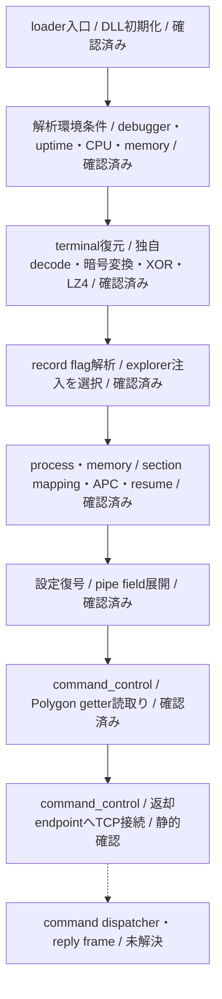
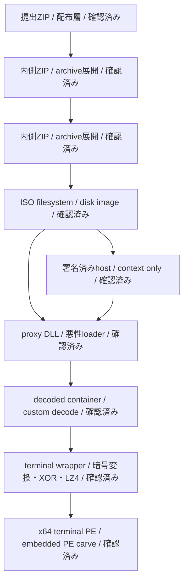
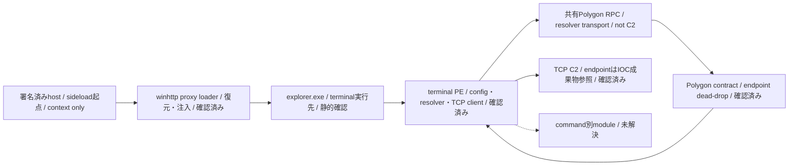

# 全体ロジック

## 静的可視化

### 実行フロー

### 感染チェーン

### モジュール関係

## 処理段階

| phase ID | 根拠 | 判定 |
|---|---|---|
| `loader_execution` | 署名済みhostのWINHTTP importと同居DLL、DLL入口 | 確認済み |
| `defense_evasion` | debugger、uptime、CPU数、memory量の条件 | 確認済み |
| `payload_decoding` | containerからterminal PEまでのhash固定復元 | 確認済み |
| `process_memory` | explorer探索、section mapping、suspended thread、APC、resume | 現recordで選択済み |
| `command_control` | 設定復号、Polygon `eth_call`、ABI decode、TCP slot binding | 確認済み |

## 比較プロファイル

- 共通phase ID: `loader_execution`、`defense_evasion`、`payload_decoding`、`process_memory`、`command_control`
- 復元層: nested ZIP → ISO → signed host／proxy DLL → custom container → shellcode wrapper → x64 terminal PE
- module役割: sideload host、proxy loader、explorer注入、terminal config、blockchain resolver、TCP client
- 特徴的な挙動: pipe区切り設定、共有RPC failover、Solidity ABI dynamic string endpoint、3接続slot
- コードfingerprint: 現在のMCP hash応答が無効なため比較不能。層、module、設定grammar、関数役割で比較

## 他ケースとの比較

### `c240b8b5400a…` — 優先度：中、score：3/6独立軸

[既存ケース](../c240b8b5400a53cae0401e1c38b5a61fd5796ce6ff74b90724de12c334e50d86/OVERALL-LOGIC.md)とは、次の独立軸が一致します。

- 感染・復元層: image filesystem、署名済みhost／`winhttp` proxy、x64 terminal。
- module構成: sideload loaderから復元terminalへ移行。
- 設定・機能: pipe区切りx64設定grammarと同一の設定資源URL。

一方、既存ケースではterminalをTriage memoryから再構築しており、本ケースのcustom container復元、explorer注入flag、Polygon resolverは記録されていません。共通builderまたは系譜を示す比較候補ですが、同一campaign、operator、actorを確定しません。

## 制約

- 図は静的call／親子関係の要約です。検体実行による動的再現ではありません。
- Triageの時間相関は[TRIAGE.md](TRIAGE.md)へ分離しました。
- terminalのcommand dispatcher以降は未解決であり、図では点線にしています。
